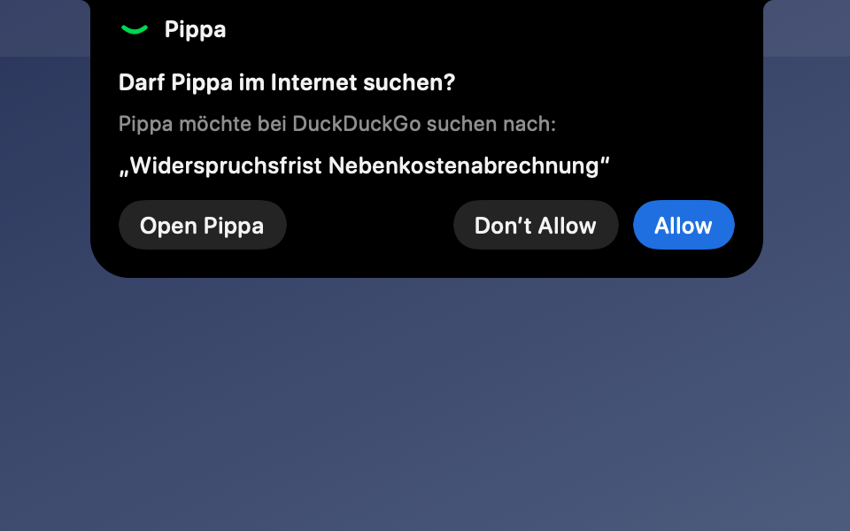
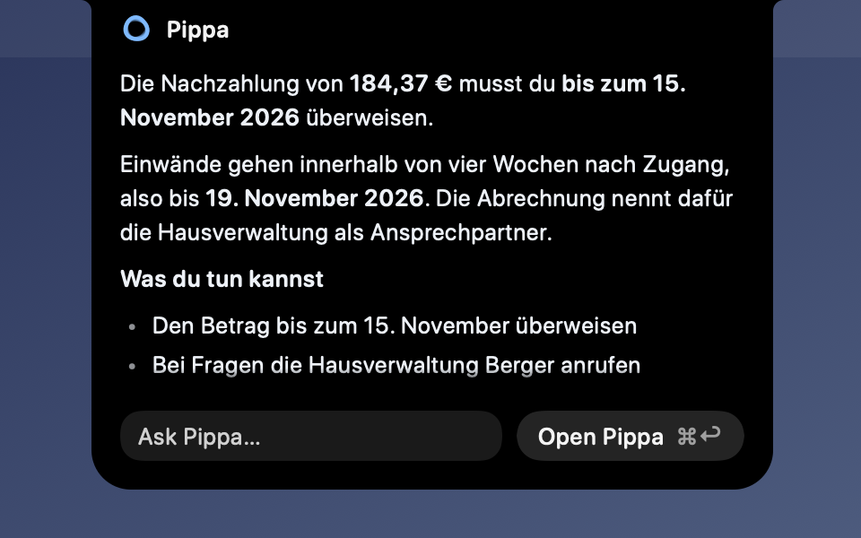
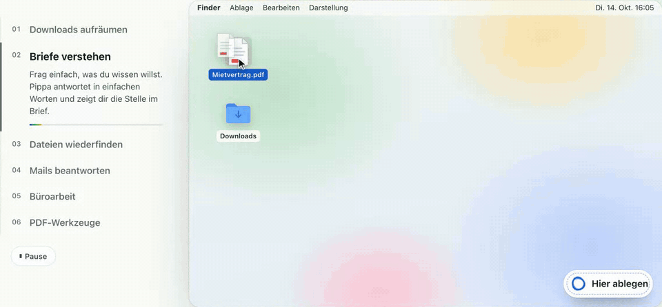

<p align="center"></p>
<h1 align="center">Pippa</h1>
<p align="center"><b>The AI assistant that actually gets things done.</b><br>
Free for the Mac: letters explained, photos to one PDF, mail drafts and appointments. Her AI runs on your Mac.</p>

<p align="center">
  
  
  
  
  
  <a href="LICENSE"></a>
  <a href="https://github.com/tschnorpfeil/pippa/releases/latest"></a>
</p>

<p align="center">
  <picture>
    <source media="(prefers-color-scheme: dark)" srcset="docs/images/pippa-window-dark.png">
    
  </picture>
  <br><sub>Pippa 0.6.5 on macOS 26, drawn by the app's own snapshot mode with made-up sample data.</sub>
</p>

Cloud assistants read your documents on their servers, and most local AI apps stop at a chat window. Pippa works with your Mac and hands back finished results:

- **Letter explained.** What a letter wants from you, by when, and the sentence that says so. A PDF or a phone photo works. Ask, and the deadline goes into Reminders or Calendar. Check amounts and dates against the original.
- **Ready to send.** Photos and scans become one PDF in your order; she checks that every page made it in and can aim for a size limit you set (say, 10 MB). Drop them and press **One PDF**: that works without any AI download.
- **Found and sorted.** Files by what's in them, the newest version first. Ask her to rename or move them; a file she removes goes to the Trash, never deleted for good.

Also: unsent reply drafts in Mail (you send them; she never does), Calendar entries, reminders, photos from your library and the web after she asks you.

Open Pippa from the Dock or press ⌥ Space, then just ask.

**Pippa Island** sits at the notch, or under her menu bar symbol on a Mac without one. It shows what she is working on, step by step; ⌥ Space opens it for a quick question, and you can drop files on it. **Open Pippa** takes the conversation to the full window.

<p align="center">
  
  
  <br><sub>Pippa Island asking for your OK, and with an answer. Drawn by the app's snapshot mode with made-up sample data; her sample answers are in German.</sub>
</p>

When she needs your OK, for example before a web search or a command that changes files, she asks right where you are, in the conversation and on Pippa Island, with one clear **Allow** next to **Don’t Allow**, never in a separate window.

The chat window, Pippa Island and Settings share one look: almost black in Dark Mode, warm paper in Light Mode, and blue only for what you can act on. Each conversation stays in the sidebar, which you can search. The question field says which AI answers: the one on this Mac, or the online AI you chose. Next to the answer, a side panel shows what she read (which pages), what she changed on your Mac, which dates she checked against the source, and how full the conversation is. Settings has four pages, **General**, **AI**, **Permissions** and **Updates**; Permissions shows at a glance what Pippa may use on this Mac.

<p align="center"><a href="https://github.com/tschnorpfeil/pippa/releases/latest/download/Pippa.dmg"><b>Download Pippa.dmg</b></a> (under 100 MB, signed and notarized) · <a href="https://heypippa.app/en/">Website</a> · <a href="https://github.com/tschnorpfeil/pippa/releases/latest">What's new</a></p>

<p align="center"><sub>Apple silicon (M1 or later), macOS 26.2 or later. One PDF from photos works right away. For the rest, her AI on your Mac needs 16 GB of memory; she checks your free disk space and asks before downloading it, about 5.4 GB (<a href="#will-it-run-on-my-mac">details</a>). If oMLX, LM Studio or Hugging Face already has the same model, she uses it instead of downloading it again. Smaller Mac, or prefer an online AI? Sign in with ChatGPT or add your own key.</sub></p>

<p align="center"><br>
<sub>Scripted demo from an earlier version of the website, with made-up files. Not a live AI session.</sub></p>

**Private by default.** Her built-in AI runs on your Mac. No account, no tracking in the app. Prefer an online AI? Connect a provider in Settings, sign in or add an API key, choose a model, and switch it on. Providers and login methods come from the bundled Pi release, including Anthropic, OpenAI/ChatGPT, OpenRouter, OpenCode, and xAI. While it's on, your conversations and what Pippa reads for them go to that service. Mail, Calendar and Reminders may sync through your accounts, and she asks before searching the web. More in [Privacy and permissions](docs/privacy-and-permissions.md).

## Why Pippa

Keep ChatGPT if you like it: Pippa can use your subscription as her online AI.

| | Pippa | ChatGPT & Claude apps | Local AI chat apps | Apple Intelligence |
|---|---|---|---|---|
| What you get back | One PDF, a moved file, a reminder, an unsent Mail draft | Answers; some modes also work on your files | Mostly chat answers; a few also edit files | Rewrites, summaries and Shortcuts actions you build |
| First useful result | One PDF from your photos right after install; the rest after a one-time AI download, or right away with an online AI | After you sign in | After an AI download | On by default on supported Macs, once Apple's download has finished |
| Where your letter is read | On your Mac by default; online AI only if you turn it on | On the provider's servers | On your computer by default | On the device, or on Apple's Private Cloud Compute |
| Letters and deadlines | Quotes the sentence behind each deadline | Capable, once you upload the letter | General-purpose chat | General summaries |
| Mail, Calendar, Reminders | Unsent Mail drafts, Calendar events, reminders | Through connectors, mostly to online accounts | Varies; a few draft mail or add events | Built into Apple's apps |
| Cost, account, code | Free, no account, open source (MIT) | Account needed; paid plans for more; closed source | Mostly free, no account; many open source | Included with supported Macs; closed source |

<sub>As of November 2026; other apps change quickly.</sub>

## What she can do

- **Files and PDFs:** one PDF from photos and scans, aimed at a size limit if you give one; files found by what's in them; renaming, moving and sorting into folders, with the Trash instead of deleting.
- **Letters and documents:** what a letter wants and by when, with the passage that says so; questions about PDFs, Word files, spreadsheets and photos of documents; summaries, shorter or clearer text, checklists from your notes.
- **Mail, Calendar and Reminders:** find and read your newest matching mails and their document attachments, open the exact read mail from the source under her answer, and write an unsent draft in Mail for you to review and send; read your calendar and reminders, and add appointments and reminders when you ask.
- **Finding things:** files on your Mac and in iCloud Drive, photos in your library, and the web after she asks you.
- **Remembering:** a short list of facts you tell her about yourself, such as your doctor's name. You can ask her to forget them.
- **Quick questions:** press ⌥ Space and ask in Pippa Island at the top of the screen, or drop a file on it. **Open Pippa** takes the conversation to the full window.

More, with examples and limits: [What Pippa can do](docs/what-pippa-can-do.md).

## Will it run on my Mac?

You need a Mac with **Apple silicon (M1 or later)** and **macOS 26.2 or later**. Every Apple silicon Mac can update to it for free in System Settings > General > Software Update. Intel Macs are not supported.

One PDF from photos and scans works without any AI download. For everything else, Pippa uses one AI on your Mac, Ornith 1.5 9B, and asks before downloading it. With an online AI switched on, she works without the download.

| Your Mac's memory | Pippa's AI on your Mac |
|---|---|
| Less than 16 GB | None; use an online AI (ChatGPT or your own key) |
| 16 or 18 GB | Download about 5.4 GB, shorter context |
| 24 GB or more | Download about 5.4 GB |

Before the download, Pippa checks that there is enough free disk space and tells you how much more is needed. If Hugging Face is blocked or drops, she continues from a verified copy on GitHub Releases. If her AI runs short of memory on your Mac, she tells you briefly and what helps. She never brings up Apple's window asking you to install developer tools. If the same model is already on your Mac from oMLX, LM Studio or Hugging Face, Pippa uses it instead of downloading it again. Which AI, and why: [Pippa's local AI](docs/models.md).

## Good to know

- **Local AI can miss details.** Check important names, amounts and dates against the original. Full dates (with a year, including nearby ones) in her answer that appear in nothing she read get a note saying she worked them out herself; dates written without a year are not checked. If Pippa gets something wrong, [open an issue](https://github.com/tschnorpfeil/pippa/issues) with the version, what you asked and what happened, using made-up examples.
- **Answers may be in German.** Pippa's own abilities for letters and deadlines are written in German.
- **Nothing is deleted for good.** A file she removes goes to the Trash, and moves never overwrite another file.
- **She acts when you ask.** If you ask her to add a reminder or move a file, she does it without asking again. The card under her answer shows what she actually did; check the result.
- **She asks in the conversation.** Before her first web search in an answer, or before a command that goes online or changes your files, a card in the conversation (and in Pippa Island) asks you: **Allow** or **Don’t Allow**.
- **She runs outside the App Sandbox** so she can work with your folders and Mac apps; a sandboxed app couldn't. macOS still asks before she reaches Documents, Calendar or Photos, and **Settings > Permissions** shows what you have allowed. Details: [Privacy and permissions](docs/privacy-and-permissions.md).
- **Updates arrive inside the app.** Pippa checks daily and installs when you quit or after a while without input, never in the middle of your work. **Settings > Updates** shows your version and checks by hand.
- **Uninstall:** [how to remove Pippa and her files](docs/privacy-and-permissions.md#remove-pippa).

## Build from source

You need an Apple silicon Mac with macOS 26.2 or later, and the Command Line Tools with Swift 6 (`xcode-select --install`). Xcode is not needed.

```sh
scripts/build-app.sh                        # dist/Pippa.app
swift run --package-path app PippaChecks    # checks, no AI download needed
```

Architecture, checks and releases: [Developing Pippa](docs/development.md). Before a pull request, read [Contributing](CONTRIBUTING.md).

## Credits and license

Built on [Pi](https://github.com/earendil-works/pi), [oMLX](https://github.com/jundot/omlx) and [MLX](https://github.com/ml-explore/mlx), [pi-web-access](https://github.com/nicobailon/pi-web-access), [Node.js](https://nodejs.org), [Sparkle](https://sparkle-project.org) and the open [Ornith](https://huggingface.co/ornith-ai/Ornith-1.5-9B-MLX-4bit) model. Full list: [THIRD_PARTY_NOTICES.md](THIRD_PARTY_NOTICES.md).

[MIT licensed](LICENSE), © 2026 Tobias Schnorpfeil. Pippa is an independent project, not affiliated with Apple, Microsoft, OpenAI, Anthropic, Ornith AI or Earendil Works. Mac and macOS are trademarks of Apple Inc.
