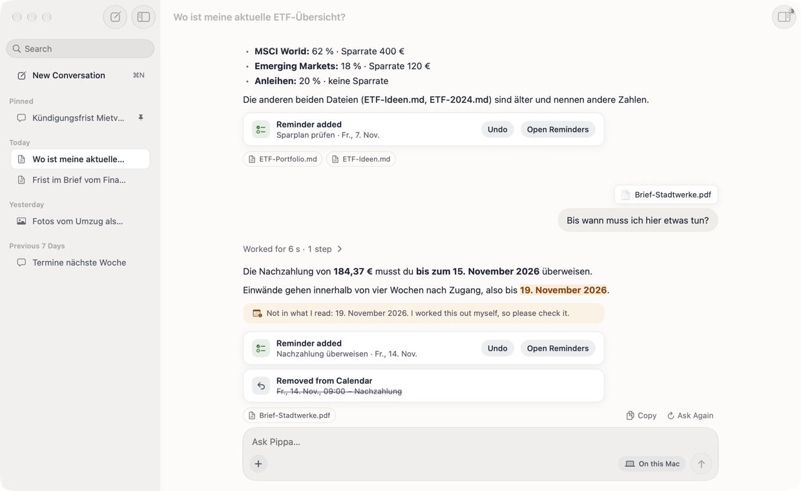
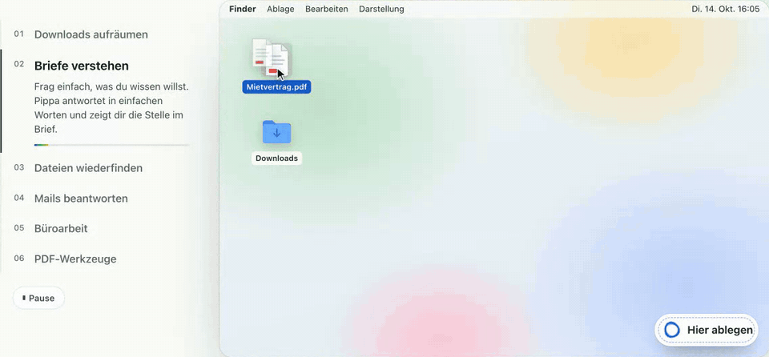

# What Pippa can do

Drop files on Pippa, bring her up with ⌥ Space, or just ask her something. She hands back the result: a file, an
answer with the passage it comes from, a draft, an event or a reminder. The [README](../README.md) has the short
version.

  <picture>
    <source media="(prefers-color-scheme: dark)" srcset="images/pippa-window-dark.png">
    
  </picture>

One job needs no AI at all: drop photos, scans or PDFs and press **One PDF**. Everything else uses her AI: the local AI
she downloads once for your Mac, or an online AI you switch on in Settings under **AI**. Each conversation is kept in
the window's sidebar, so you can search for it and pick it up later.

**Pippa Island** sits at the notch, or under Pippa's menu bar symbol on a Mac without one. It shows what she is working
on, such as the file she is reading. Press ⌥ Space to open it for a quick question, drop a file on it, or click
**Open Pippa** to continue in the full window. You can switch it off in Settings under **General**.

## Everyday jobs

| What you need | How Pippa helps |
|---|---|
| **A letter you can act on** | Ask what it says, what you need to do and by when. She quotes the passage her answer comes from, and flags full dates (with a year, including nearby ones) in her answer that do not appear in what she read; dates without a year and deadlines measured from receipt still need checking against the original. A PDF or a phone photo works. |
| **A PDF ready to send** | Drop photos or scans and press **One PDF**, or ask for one PDF in your own words. Pippa keeps your order, checks every page and reports the real file size. Give a size limit, such as 10 MB, and she aims for it. Your originals stay unchanged. |
| **An appointment or a reminder** | Ask Pippa to add it to Calendar or Reminders, or to add the deadline from a letter. A card under her answer shows what was actually added. |
| **What's coming up** | Ask about today, this week or a range of dates. She reads your calendar and your open reminders. |
| **A file you can't find** | Ask "Where is the invoice for my helmet?" Pippa searches your Mac's Spotlight index by content, file name and folder, optionally by year or kind, and lists the newest first. |
| **A tidier folder** | Ask her to rename a file, move it, or sort a folder's files into subfolders. Moves never overwrite another file. A file she removes goes to the Trash, never deleted for good. |
| **A reply ready to review** | Pippa finds and reads your newest matching mails in Apple Mail, including document attachments, opens the exact read message when you click its source under her answer, and saves an unsent draft in Mail for you to review and send. She never sends mail. |
| **A clearer piece of writing** | Shorten a text, make it clearer and friendlier, fix spelling, summarize it or turn notes into a checklist. |

A few more things she can do when you ask:

- **Documents.** Questions about PDFs, Word files, spreadsheets and photos of documents, with text recognition for
  scans.
- **The app in front.** Ask about what's open, for example the mail you're reading.
- **Photos.** Find matching photos in your Photos library.
- **The web.** Look something up online, after showing you the exact search text and getting your OK.
- **Remembering.** Tell her a fact about yourself, such as your doctor's name, and she keeps it for later
  conversations. Ask her to forget it, and it's gone. She never keeps account, card or ID numbers or passwords.

## Good to know

- **Local AI can miss details.** Answer quality and speed depend on your Mac and the task. Check important names,
  amounts and dates against the original.
- **Spotlight finds what it has indexed.** Files that Spotlight hasn't indexed, or cloud files that aren't downloaded,
  can be missing. An empty result doesn't prove a file isn't there.
- **macOS asks first.** The first time Pippa needs your Documents folder, Calendar, Reminders, Photos or Mail, macOS
  asks you. In Pippa's Settings, the Permissions page shows what is allowed and opens the right place in System
  Settings if you want to change it. More in [Privacy and permissions](privacy-and-permissions.md).
- **Pippa asks in the conversation.** Before her first web search in an answer, or before a command that goes online
  or changes your files, a card in the conversation asks you, with **Allow** and **Don’t Allow**. The same question
  shows in Pippa Island, so you can answer it without switching windows.
- **Setting up on a new Mac.** Before the AI download, Pippa checks that there is enough free disk space and tells you
  how much more is needed. If Hugging Face is blocked or fails, she continues from a verified copy on GitHub. If her AI
  runs short of memory, she tells you briefly and what helps, and if files in her own AI installation are missing she
  repairs them. She never brings up Apple's window asking you to install developer tools.
- **Something didn't work?** [Open an issue](https://github.com/tschnorpfeil/pippa/issues) with the version, what you
  asked, what happened and what you expected. Use made-up examples and remove personal details from screenshots.

## Demo

This animation was recorded from an earlier version of the scripted demo on [heypippa.app](https://heypippa.app/en/),
with made-up files. It is not a recording of a live AI session, and the current app looks different (see the window at
the top of this page).

  

