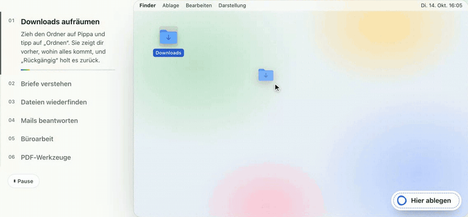
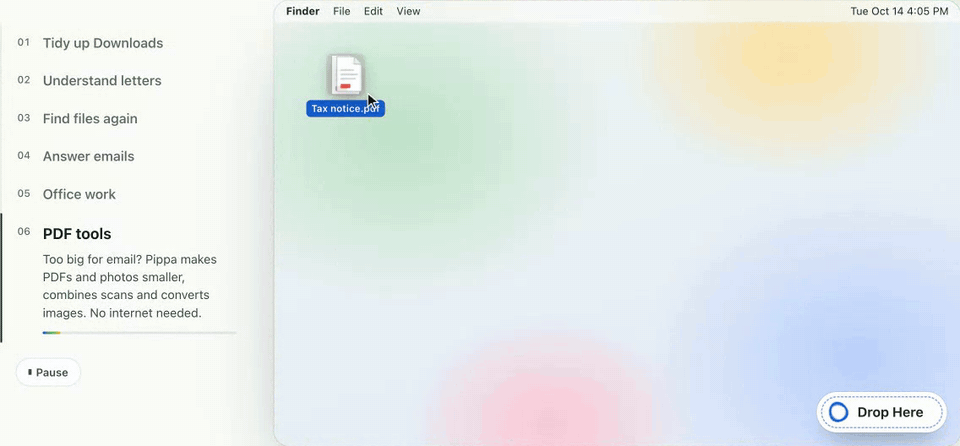
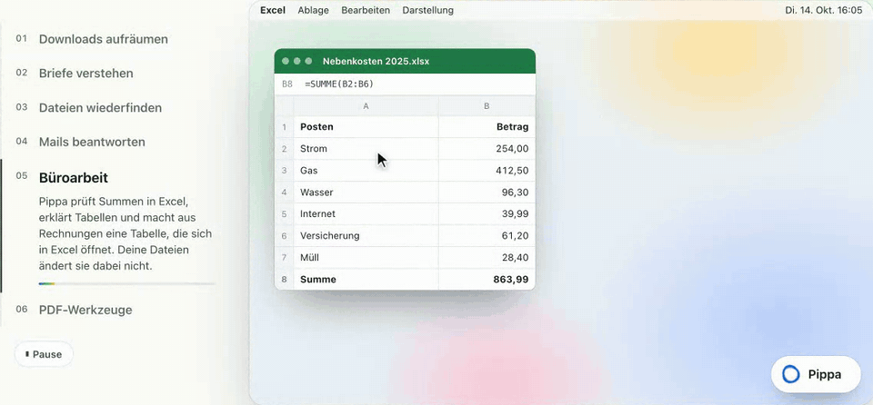
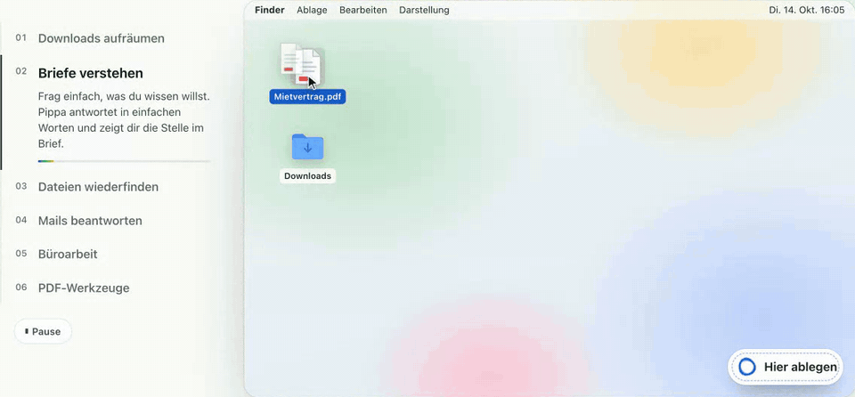

# What Pippa can do

Drop files on Pippa, bring her up with ⌃⌥ Space, or just ask her something. She hands back the result: a file, a tidied
folder, an answer with the passage it comes from, a draft, an event or a reminder. The [README](../README.md) has the
short version.

## Without any AI download

These jobs run in Pippa's own code, right after you install her, even on macOS 15 without Apple Intelligence:

- **Ready to send.** Photos and scans become one PDF in the order you choose. Pippa checks every page and the order, and
  reports the real file size. Set a size limit, such as 10 MB, and she shows whether the result fits. Up to 50 files of
  up to 500 MB each, and up to 300 pages per batch. If a smaller version can't be verified page by page, she keeps the
  original quality and says so.
- **Make smaller.** Smaller PDFs and photos; smaller photos leave out location data. If a file can't get noticeably
  smaller, she says so.
- **As JPG, as PNG, as PDF.** Copies of your images in another format.
- **Remove Location.** PNG copies of your photos without location or camera details.
- **Extract Text.** The text from photos and PDFs (1 to 200 pages), with text recognition for scans.
- **Tidy Up.** Drop a folder such as Downloads and see the new folders first. Nothing moves until you say so, and Undo
  puts everything back. In a folder's overview, this is **Organize by Type and Month**.
- **Morning overview** (optional, see below).

Your originals stay unchanged; every result is a new file. You choose where to save it or drag it where you need it.
If saving fails, the result stays available, and **Saved File Tasks…** in the menu bar menu brings back unfinished requests after a restart.

## Everyday jobs

| What you need | How Pippa helps |
|---|---|
| **A PDF ready to send** | Combine photos or scans into one PDF, make files smaller, convert images to JPG or PNG, or extract text from images and PDFs. In chat, Pippa can also make a PDF ready to send as part of a longer request. |
| **A folder you can find your way in again** | Drop a folder and choose Tidy Up. Review the new folders before anything moves; Undo takes the moves back. |
| **A letter you can act on** | Ask what it says, what you need to do and by when. She quotes the passage her answer comes from. A PDF or a phone photo works. Letter and deadline detection is tuned for German documents. |
| **An appointment or a reminder** | Ask Pippa to add it to Calendar or Reminders, or to add the deadlines from a letter. The line under her answer shows what was actually added. **Check status** looks up an earlier reminder without creating another one. |
| **A file you can't find** | Ask "Where is the invoice for my helmet?" Pippa searches your Mac's Spotlight index, by content and optionally by year, and links to the files she finds. Invoice and insurance searches also match folder names in the other language (German or English). |
| **A reply ready to review** | Work from the message you selected in Apple Mail. She writes the reply text for you to copy, or, if you ask in chat, saves an unsent draft in Mail for you to review and send. If an email proposes an appointment, she can check your calendar, add it and draft the answer. |
| **Less spreadsheet busywork** | Check a total in Excel: she recomputes it and finds rows it leaves out, totals that don't match and numbers stored as text. Choose **Invoices as a Spreadsheet** to turn a stack of invoices into one new spreadsheet, one row per invoice with a total per currency. Your files stay unchanged. |
| **A clearer piece of writing** | Shorten a text, make it clearer and friendlier, fix spelling, summarize it or turn notes into a checklist. On macOS 26, when Apple Intelligence is turned on, Pippa lets it handle short selections. |

A few more things she can do when you ask:

- **Explain and check.** Summarize a document and what to do about it, sort a document into the right kind, or check
  a general statement (for example about a deadline) against sources on the web, quoted word for word.
- **Drafts.** Write a reply, a cancellation or an objection as a draft, ready for you to check and copy.
- **Photos.** Find matching photos in your Photos library and show previews.
- **The web.** Look something up online, after showing you the exact search text and getting your OK.

## Morning overview

Choose the calendars and reminder lists you want checked, plus the days and a time. Pippa puts today's appointments
and due reminders into a local overview, with links back to Calendar and Reminders. Missing access is shown, not
skipped silently. Optional notifications contain no appointment or task details.

The morning overview starts off. It works while Pippa and your Mac are running, catches up once within four hours of
the chosen time and does not replay missed days. Overdue reminders cover the previous 30 days.

## Good to know

- **Local AI can miss details.** Answer quality and speed depend on your Mac and the task. Check important names,
  amounts and dates against the original.
- **Spotlight finds what it has indexed.** Files that Spotlight hasn't indexed, or cloud files that aren't downloaded,
  can be missing. An empty result doesn't prove a file isn't there.
- **macOS asks first.** The first time Pippa needs your Documents folder, Calendar, Reminders, Photos or Mail, macOS
  asks you. If access was denied, a blocked action offers **Open System Settings**. More in
  [Privacy and permissions](privacy-and-permissions.md).
- **Something didn't work?** [Open an issue](https://github.com/tschnorpfeil/pippa/issues) with the version, what you
  asked, what happened and what you expected. Use made-up examples and remove personal details from screenshots.

## Demos

These animations were recorded from an earlier version of the scripted demo on [heypippa.app](https://heypippa.app/en/),
with made-up files. They are not recordings of live AI sessions, and the current app may look different.

  

  
  

  

